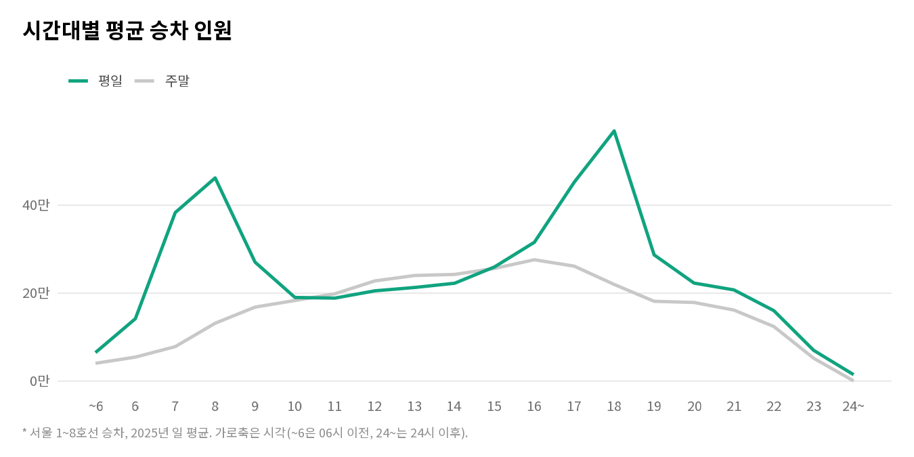

# SH-Statistical_Reasoning

R로 2025년 서울 지하철 승차 인원과 날씨의 관계를 시간대별로 분석한 과제 저장소다.

## 질문과 결론

**질문.** 비 오는 날 지하철 승객은 줄어드는가? 날씨의 영향은 하루 전체가 아니라 낮 시간대(09~15시)에서 봐야 하는가?

- 비 온 평일에는 승차가 줄었다. 공휴일을 빼고 일하는 날끼리 비교하면 하루 전체 기준 −2.6%다.
- 공휴일을 평일로 둔 채 비교하면 감소율이 −5.4%로 두 배 넘게 부풀려진다. 승객이 적은 비 온 공휴일이 "비 온 평일"에 섞였기 때문이다.
- 낮 시간대(−3.1%)가 출퇴근 시간대(−2.0%)보다 더 줄었지만, 부트스트랩 95% 구간이 0을 포함해 이 차이는 우연과 구별되지 않는다.



자세한 판단과 근거는 [midterm_exam/document.md](midterm_exam/document.md)에 있다.

## 데이터

| 자료 | 출처 | 단위 |
|---|---|---|
| 역별 일별 시간대별 승하차 인원 (2025) | 서울교통공사, 서울 열린데이터광장 | 날짜 × 역 × 승차/하차, 시간대 20개 열 |
| 일 평균기온·일강수량 (2025) | 기상청 기상자료개방포털, ASOS 서울(108) | 날짜 |
| 공휴일 (2025) | 공공데이터포털 | 날짜 |

원자료는 EUC-KR 인코딩이며 `dataset/raw/`에 그대로 두고 수정하지 않는다. 지하철 자료는 서울교통공사가 운영하는 1~8호선만 담고 있다.

## 파이프라인

```
원자료 (dataset/raw)
  │  notebooks/04 전처리
  ▼
subway_clean.csv (dataset/working)
  │
  ▼
01 긴 형식 ──▶ 02 시각 추출 ──▶ 03 시간대 곡선
  │
  ▼
04 날씨 조인·증감률 ──▶ 05 낮 시간대 판단
  │
  ▼
06 공휴일 반영 ──▶ 07 한계 검증
```

| 단계 | 파일 (`midterm_exam/code/`) | 하는 일 | 결과 |
|---|---|---|---|
| 1 | `01_long_format.R` | 시간대 20개 열을 `시간대`·`인원` 두 열로 세운다 | 199,290행 → 3,985,800행 |
| 2 | `02_datetime.R` | 시간대 문자열에서 시각을 꺼내 날짜시각형 열을 만든다 | `시`, `일시` 열 |
| 3 | `03_weekday_profile.R` | 평일·주말의 시간대별 평균 승차를 비교한다 | 평일 봉우리 08시·18시 |
| 4 | `04_rain_by_hour.R` | 날씨를 조인하고 비 온 평일의 시간대별 증감률을 구한다 | 모든 시간대 −4.7~−8.3% |
| 5 | `05_daytime_judgment.R` | 출퇴근·낮·늦은 밤으로 묶어 주장을 판단한다 | 낮과 출퇴근의 차이 없음 |
| 6 | `06_holidays.R` | 공휴일을 쉬는 날로 바꿔 다시 계산한다 | 하루 −5.43% → −2.61% |
| 7 | `07_limits.R` | 계절 통제, 부트스트랩, 강수량 분포로 한계를 확인한다 | 낮−출퇴근 차이는 우연과 구별 안 됨 |
| 점검 | `08_run_all.R` | 01~07을 새 R 세션에서 순서대로 실행한다 | 오류 없이 종료 |

01~07은 앞 파일이 만든 객체를 이어서 쓰므로 같은 R 세션에서 순서대로 실행한다.

## 폴더 구조

```
ReadTheWorld/
├── dataset/
│   ├── raw/                 원자료 (읽기 전용)
│   └── working/             전처리 결과 (subway_clean.csv, daily.csv)
├── notebooks/               강의 실습 1~5장 노트북
├── scripts/                 ggplot2 시각화 연습
├── output/figures/          실습 그림
└── midterm_exam/
    ├── code/                과제 R 파일 01~08, 노트북
    ├── data/                공휴일 목록
    ├── output/figures/      과제 그림 3장
    └── document.md          서술 답안 (과제 2, 5, 6, 7)
```

## 실행 방법

필요한 것은 R 4.6, tidyverse, showtext다. 한글 글꼴(Noto Sans KR)을 Google Fonts에서 내려받으므로 처음 실행할 때는 인터넷 연결이 필요하다.

```bash
Rscript midterm_exam/code/08_run_all.R
```

저장소 맨 위, `midterm_exam`, `midterm_exam/code` 중 어디서 실행해도 작업 폴더를 `midterm_exam`으로 맞춘 뒤 01~07을 실행하고, 그림을 `midterm_exam/output/figures/`에 저장한다.

## 사용한 Claude 도구

- **Claude Code**: 과제 1~7의 R 코드 작성, 계산, 그림 저장을 단계별로 진행했다. 단계마다 행 수, 결측, 일수를 출력해 결과를 검증했다.
- **ponytail**: 필요한 만큼만 짧게 쓰는 코드 작성 규칙을 적용했다.
